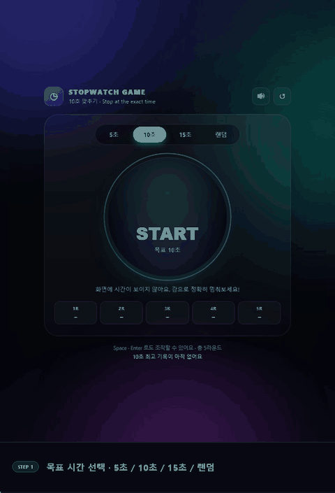

# ⏱️ 스탑워치 게임 · 10초 맞추기

시계가 보이지 않는 상태에서 **목표 시간에 최대한 가깝게 멈추는** 웹 게임입니다.
빌드 도구 없이 `index.html`만 열면 바로 플레이할 수 있습니다.



> 더 선명한 영상: [assets/demo.mp4](assets/demo.mp4)

---

## 🎮 플레이 방법

1. **목표 시간 선택** — 5초 / 10초 / 15초 / 랜덤
2. **START** — 3·2·1 카운트다운 후 타이머가 시작됩니다.
3. **STOP** — 화면에 시간이 표시되지 않으니, 감으로 정확히 멈추세요.
4. 결과 카드에서 **오차와 라운드 점수**를 확인합니다.
5. 총 **5라운드**를 마치면 합산 점수와 등급이 나옵니다.

키보드로도 조작할 수 있습니다: `Space` · `Enter`

## 🧮 점수 규칙

- 오차 = |목표 시간 − 실제로 멈춘 시간| (ms)
- 라운드 점수 = `max(0, round(1000 − 오차 × 1.5))`
- 5라운드 합산 최대 **5,000점**
- 최고 기록은 모드별로 브라우저 `localStorage`에 자동 저장됩니다.

| 합산 점수 | 등급 |
| --- | --- |
| 4,600점 이상 | 그랜드마스터 🏆 |
| 3,800점 이상 | 마스터 🥇 |
| 3,000점 이상 | 숙련자 🥈 |
| 2,100점 이상 | 견습생 🥉 |
| 그 외 | 루키 🌱 |

## ✨ 특징

- 순수 HTML / CSS / JavaScript — 프레임워크·빌드 과정 없음
- 다크 글래스 UI, 모바일 대응 레이아웃
- 사운드 on/off, 게임 초기화, 라운드별 기록 표시
- `localStorage` 기반 모드별 최고 기록

## 🚀 실행

```bash
# 그냥 index.html을 브라우저로 열어도 됩니다.
# 로컬 서버로 열려면:
python -m http.server 5500
# → http://localhost:5500
```

## 📁 프로젝트 구조

```
stopwatch-game/
├── index.html        # 화면 구조
├── styles.css        # 스타일 (다크 글래스 UI)
├── game.js           # 게임 로직 (라운드, 점수, 기록 저장)
└── assets/
    ├── demo.gif      # 플레이 데모 (README 임베드)
    ├── demo.mp4      # 플레이 데모 (고화질)
    └── screenshot.png
```

## 📄 라이선스

MIT
